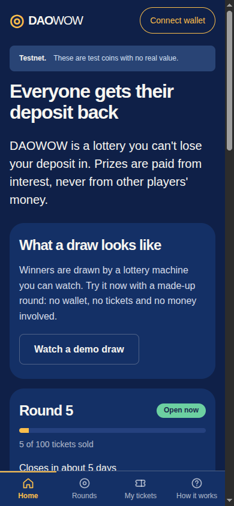
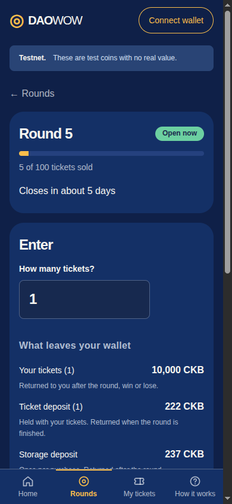
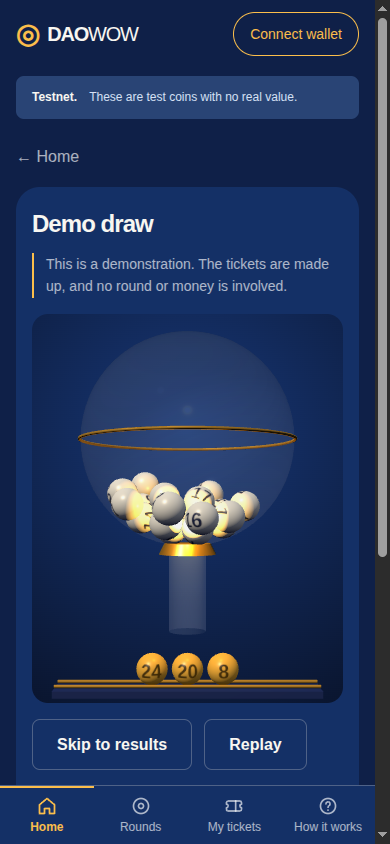

# DAOWOW

A no-loss lottery on [Nervos CKB](https://www.nervos.org/). Everyone gets their
deposit back. Prizes are paid from interest, never from other players' money.

**Live on testnet: [daowow.org](https://daowow.org)** (test coins, no real value)

<p>
  
  
  
</p>

## How it works

1. **Buy tickets.** Each ticket is a fixed deposit of CKB. Entering mints one
   claim NFT per ticket into your own wallet.
2. **The pool earns interest.** When entries close, every ticket's deposit goes
   into the [Nervos DAO](https://github.com/nervosnetwork/rfcs/blob/master/rfcs/0023-dao-deposit-withdraw/0023-dao-deposit-withdraw.md),
   CKB's built-in savings mechanism. A round commits to one or two 180-epoch
   cycles (about 30 days each) and its deposits are held for one cycle more,
   so a one-cycle round pays out about 60 days after its deposit.
3. **Winners are drawn.** Winning ticket positions come from block hashes that
   did not exist when entries closed.
4. **Everyone is paid back.** Each depositor receives their full deposit.
   The interest the pool earned is split between the winning tickets.

A round with few entrants has a small prize pool. Interest is proportional to
how much was deposited and for how long, and it is not topped up from anywhere.

## Design

**No custody.** There is no operator key anywhere in the protocol. An entry
can only be spent into the round's own DAO deposit, or refunded to the wallet
that made it. The DAO deposit can only be withdrawn into the round's own
settlement. Anyone may submit the transactions that move a round forward, and
none of them can redirect funds.

**Rounds are immutable.** Ticket price, entry window, ticket limits, DAO term
and the prize table are committed when the round is created. Contracts are
deployed by data hash, not Type ID, so the code behind a live round cannot be
swapped either.

**Entries are committed before the draw.** Entries append to shard cells that
keep a running commitment. After the window closes the shards are frozen and
the entry set is sealed on chain. Only then is the randomness taken.

**The draw is recomputable.** The seed combines the round's identity with four
block hashes: the block that sealed the entries and the blocks 64, 128 and 192
after it. The app derives the result itself and checks it against the record
posted on chain. `tools/verify-draw.mjs` runs the Rust and JavaScript
implementations against a live round.

**Prizes scale with the field.** More tickets sold opens more prize places,
from a table fixed at creation. Rounding always goes to first place, so no
shannon is left unowned.

**Tickets are transferable, deposits are not.** The claim NFT carries the
right to a ticket's prize and can be sent to another wallet. The deposit and
any refund stay bound to whoever paid.

### What this is not

The randomness is **not a VRF and not a beacon**. It relies on block hashes
that miners produce. A miner who controlled the specific blocks could discard
unfavourable ones. Sealing the entries first, and spreading the entropy over
four blocks across roughly half an hour, raises the cost of that attack. It
does not make it impossible.

The app also reads the chain through a single public node, so what it shows is
as trustworthy as that node.

## Status

Testnet only. **Not audited. Do not use with real funds.**

| Stage | Contracts | Devnet | Testnet |
|---|---|---|---|
| Create round, enter, claim NFT mint | done | proven | live |
| Refund of entries a round did not accept | done | proven | live |
| Freeze, aggregate into the Nervos DAO | done | proven | live |
| Seal, entropy, draw | done | proven | live |
| DAO withdrawal and deposit payout | done | proven | tooling built; first withdrawal opens December 2026 |
| Prize redemption by ticket holders | done | proven | tooling not started |

The app is browser-only. It offers every wallet the [CCC](https://github.com/ckb-devrel/ccc)
library supports, including JoyID, MetaMask and other EVM wallets, OKX,
UniSat, Xverse, UTXO Global, Rei and Nostr signers. JoyID is the most tested;
the others are newer here. The limit of 5 tickets per wallet is an app rule
and is not enforced on chain.

## Repository

| Path | Contents |
|---|---|
| `contracts/` | On-chain scripts in Rust: `round-type`, `entry-shard-type`, `entry-lock`, `dao-lock`, `settlement-type` |
| `crates/daowow-core` | Deterministic protocol logic shared by contracts, tests and vector generation. No network code. |
| `schemas/daowow.mol` | Molecule schema for cell data and witnesses |
| `apps/web/dapp` | The app at daowow.org. Static files, no framework, no build step. |
| `apps/web/chain` | Codecs and transaction builders, ported from `daowow-core` and pinned to its test vectors |
| `tools/` | Round creation, lifecycle transaction builders, pre-signing checkers, deployment verification |
| `tests/integration` | `ckb-testtool` tests that run the compiled RISC-V binaries |
| `tests/devnet` | Full-node harness that runs whole rounds on an isolated devnet in Docker |
| `deployments/` | Deployment recipes and the testnet manifest |
| `docs/` | Protocol, architecture, threat model, validation records, design specs and plans |

`START_HERE.md`, `AGENT_HANDOFF.md` and `prototype-report.md` are the original
design brief the project was built from. They are kept as history;
`docs/protocol-v0.2.md` and `docs/architecture.md` describe the protocol.

## Build and test

Requires the Rust toolchain in `rust-toolchain.toml` with the
`riscv64imac-unknown-none-elf` target, and Node.js 20 or later.

```sh
# Contracts. The integration tests load these binaries from disk and refuse
# to run against stale ones.
for c in round-type entry-shard-type entry-lock dao-lock settlement-type smoke-minimal; do
  cargo build --release --target riscv64imac-unknown-none-elf -p "$c"
done

cargo test                               # core logic and contract integration tests
node --test 'apps/web/test/*.test.js'    # app, codecs, builders, tools
python3 -m unittest discover -s tests/devnet -v
```

The full-node devnet tests need Docker; see `tests/devnet/README.md`.

To run the app locally, serve the repository root with any static file server
and open `/apps/web/dapp/`. It reads testnet through the public node named in
`apps/web/dapp/manifest.json`.

Some operator tools and older docs default to a private LAN node address. Set
`CKB_URL`, or the manifest's `rpcUrl`, to your own node or
`https://testnet.ckb.dev`.

## Verify the deployment

After building the contracts:

```sh
node tools/verify-deployment.mjs apps/web/dapp/manifest.json
```

This fetches each deployed code cell from testnet and compares it with the
binary you just built. It is the check that the chain runs the code in this
repository.

## Security

Treat this as unaudited financial software. The threat model is in
`docs/threat-model.md` and the enforcement audit in
`docs/beta-rule-enforcement-audit.md`. Please report vulnerabilities privately
through GitHub's security advisories on this repository, not in a public issue.

## Licence

MIT. See [LICENSE](LICENSE). Vendored third-party code under `vendor/`,
`apps/web/vendor/` and `reference/upstream/` keeps its own licence.
